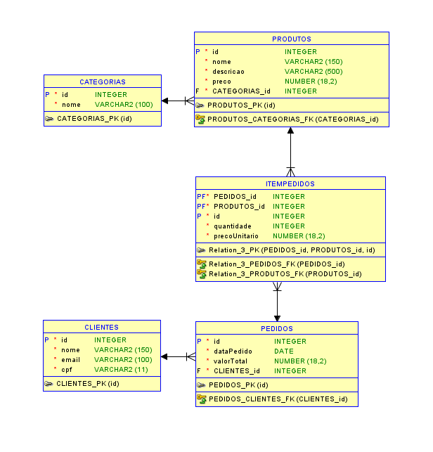
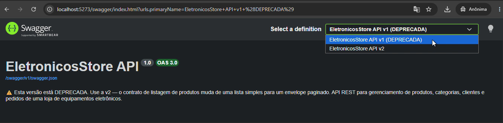

# Checkpoint .NET

## 👥 Integrantes do Grupo
* **Nome:** Pedro Sakai - **RM:** 565956 - **Turma:** 2TDSPF

---

## 🛒 Domínio Escolhido
**Loja de Equipamentos Eletrônicos**
O sistema gerencia o catálogo de produtos, categorias e o fluxo de vendas (pedidos) de uma loja
especializada em eletrônicos. O modelo foca na organização de estoque por categoria e na
rastreabilidade de pedidos realizados por clientes cadastrados.

---

## 🗄️ SGBD Utilizado
* **Oracle Database** (herdado dos CP's anteriores)
* Provider: `Oracle.EntityFrameworkCore`

---

## ESQUEMA FÍSICO DO BANCO DE DADOS


---

## 🏗️ Arquitetura

Clean Architecture em 4 camadas + 2 projetos de teste:

```
EletronicosStore.Domain          -> Entidades, regras de negócio, exceções de domínio
EletronicosStore.Application     -> Interfaces (IRepository<T>, IProdutoRepository...), DTOs, Services
EletronicosStore.Infrastructure  -> DbContext, Migrations, Repository<T> (EF Core)
EletronicosStore.API             -> Controllers, Swagger, GlobalExceptionHandler, Health Checks
EletronicosStore.Domain.Tests    -> Testes de unidade do Domain (sem mock)
EletronicosStore.Application.Tests -> Testes de unidade da Application (com Moq)
```

Os controllers **não** acessam o `DbContext` diretamente — sempre passam por
`IRepository<T>` (genérico), por repositórios específicos (`IProdutoRepository`,
`IPedidoRepository`) ou pela camada de serviço (`IProdutoService`).

---

## ▶️ Como Executar a API

### 1. Configuração do Banco
No arquivo `appsettings.json` (ou `appsettings.Development.json`) do projeto
**EletronicosStore.API**, configure sua Connection String:
```json
"ConnectionStrings": {
  "OracleConnection": "Data Source=SeuCaminhoOracle;User Id=SeuUsuario;Password=SuaSenha;"
}
```

### 2. Aplicar as Migrations
```bash
dotnet ef database update --project EletronicosStore.Infrastructure --startup-project EletronicosStore.API
```

### 3. Rodar a API
```bash
dotnet run --project EletronicosStore.API
```

### 4. Endereços úteis
| Recurso | URL |
|---|---|
| Swagger UI | `http://localhost:5273/swagger` |
| Health Check | `http://localhost:5273/health` |
| API | `http://localhost:5273/api/...` |
| Produtos v1 (deprecada) | `http://localhost:5273/api/produtos?api-version=1.0` |
| Produtos v2 (atual, paginada) | `http://localhost:5273/api/produtos` |

---

## 📚 Endpoints

| Recurso | Rota base | Operações |
|---|---|---|
| Produtos | `/api/produtos` | GET (v1 lista / v2 paginado), GET por id, POST (limitado — ver Rate Limit) |
| Categorias | `/api/categorias` | GET (all), GET por id, POST |
| Clientes | `/api/clientes` | GET (all), GET por id, POST |
| Pedidos | `/api/pedidos` | GET (all), GET por id, POST (com itens) |

Todos os endpoints usam **DTOs** de request/response (nenhuma entidade de domínio é
exposta diretamente) e estão documentados no Swagger com comentários XML e
`ProducesResponseType`. Categorias, Clientes e Pedidos são `[ApiVersionNeutral]` —
não versionados, continuam funcionando normalmente em qualquer requisição.

---

## 🧩 Repositório Genérico

- `IRepository<T>` (Application) — contrato comum a qualquer entidade que herde de `BaseEntity`
  (`GetAllAsync`, `GetByIdAsync`, `ExistsByIdAsync`, `AddAsync`, `Update`, `DeleteAsync`,
  `SaveChangesAsync`).
- `Repository<T>` (Infrastructure) — implementação via EF Core (`DbSet<T>`, `AsNoTracking`
  nas leituras).
- Registro na DI: `services.AddScoped(typeof(IRepository<>), typeof(Repository<>));`
- Usado **diretamente** nos controllers de Categoria e Cliente, e internamente pelos
  repositórios específicos `IProdutoRepository` e `IPedidoRepository` (que estendem
  `IRepository<T>` e adicionam consultas com `Include` para Categoria/Cliente/Itens).

---

## 🔀 Versionamento de API

O recurso **Produtos** (o que mais cresce no domínio) tem dois contratos convivendo:

| Versão | Status | Contrato do `GET /api/produtos` |
|---|---|---|
| `1.0` | **Deprecada** (mas funcional) | Array completo, como no CP3 — `[ { "id": 1, "nome": "..." }, ... ]` |
| `2.0` | Atual (padrão) | Envelope paginado — `{ "page": 1, "pageSize": 20, "totalItems": N, "totalPages": M, "items": [...] }` |

`GetById` e `POST` são compartilhados pelas duas versões (não há duplicação de regra de
negócio — os dois contratos chamam o mesmo `IProdutoService`).

**Como informar a versão** (as três formas funcionam):
```
GET /api/produtos?api-version=1.0        → lista antiga (v1)
GET /api/produtos                         → header X-Api-Version: 1.0 também funciona
     com header X-Api-Version: 1.0        → lista antiga (v1)
GET /api/produtos                         → sem informar nada: cai na v2.0 (envelope paginado)
```

Exemplo real — `GET /api/produtos?api-version=1.0` (contrato antigo, array simples):
```json
[
  {
    "id": 1,
    "nome": "Mouse",
    "descricao": "Mouse Gamer Logitech",
    "preco": 990,
    "estoque": 20,
    "categoriaId": 1,
    "categoriaNome": "Equipamentos"
  }
]
```
(ver `docs/02-produtos-v1-query-string.json`)

Exemplo real — `GET /api/produtos` sem informar versão (cai na v2, envelope paginado):
```json
{
  "page": 1,
  "pageSize": 20,
  "totalItems": 1,
  "totalPages": 1,
  "items": [
    {
      "id": 1,
      "nome": "Mouse",
      "descricao": "Mouse Gamer Logitech",
      "preco": 990,
      "estoque": 20,
      "categoriaId": 1,
      "categoriaNome": "Equipamentos"
    }
  ],
  "hasPrevious": false,
  "hasNext": false
}
```
(ver `docs/03-produtos-v2-sem-versao.json`)

A resposta de qualquer chamada inclui os headers `api-supported-versions` e
`api-deprecated-versions` (configurado via `ReportApiVersions = true`):
```
HTTP/1.1 200 OK
Content-Type: application/json; charset=utf-8
api-supported-versions: 2.0
api-deprecated-versions: 1.0
```
(ver `docs/04-headers-versao.txt`)

No Swagger (`/swagger`, ambiente Development), o seletor no canto superior direito troca
entre os grupos **v1** e **v2** — a descrição do documento v1 avisa explicitamente que está
deprecada:



---

## 📄 Paginação (somente na v2 de Produtos)

Query string do `GET /api/produtos` (v2):

| Parâmetro | Padrão | Regra |
|---|---|---|
| `page` | 1 | inteiro ≥ 1 |
| `pageSize` | 20 | inteiro de 1 a 100 |

- `page < 1` ou `pageSize` fora de 1–100 → **400** (`ProblemDetails`, `DomainException` mapeada pelo handler do CP3).

Exemplo real — `GET /api/produtos?page=0`:
```json
{
  "type": "about:blank",
  "title": "Não foi possível concluir a operação",
  "status": 400,
  "detail": "O parâmetro 'page' deve ser maior ou igual a 1.",
  "instance": "/api/produtos"
}
```
(ver `docs/07-erro-400-page-zero.json`)

Exemplo real — `GET /api/produtos?pageSize=9999`:
```json
{
  "type": "about:blank",
  "title": "Não foi possível concluir a operação",
  "status": 400,
  "detail": "O parâmetro 'pageSize' deve estar entre 1 e 100.",
  "instance": "/api/produtos"
}
```
(ver `docs/08-erro-400-pageSize-9999.json`)
- Página além do total → **200** com `items: []` (não é erro).
- O corte acontece **no banco** (`Skip`/`Take` no `IQueryable`, com `OrderBy(p => p.Id)` para
  garantir resultado reproduzível) — implementado em `ProdutoRepository.GetPagedComCategoriaAsync`
  e, de forma genérica, em `Repository<T>.GetPagedAsync`.
- `totalPages = Ceiling(totalItems / pageSize)`.

Exemplo real com 6 produtos cadastrados e `pageSize=3` — página 1 e página 2 não se
sobrepõem, e `hasPrevious`/`hasNext` refletem a posição corretamente:

`GET /api/produtos?page=1&pageSize=3` → ids `[1, 21, 22]`, `hasPrevious: false`, `hasNext: true`
(ver `docs/05-pagina1-pageSize3.json`)

`GET /api/produtos?page=2&pageSize=3` → ids `[23, 24, 25]`, `hasPrevious: true`, `hasNext: false`
(ver `docs/06-pagina2-pageSize3.json`)

`GetById` não pagina. `GetAll()` (sem paginação) continua existindo só para a v1.

Exemplo real — `GET /api/produtos?page=999` (muito além do total): **200**, não 404.
```json
{
  "page": 999,
  "pageSize": 20,
  "totalItems": 6,
  "totalPages": 1,
  "items": [],
  "hasPrevious": true,
  "hasNext": false
}
```
(ver `docs/09-pagina-999-vazia.json`)

---

## 🚦 Rate Limit

Endpoint limitado: **`POST /api/produtos`** (`[EnableRateLimiting("fixed")]`).

- Política: **fixed window**, **10 requisições por minuto**, particionada por IP do cliente.
- Estourou o limite → **429 Too Many Requests**, com header `Retry-After: 60` e corpo
  `ProblemDetails` (`application/problem+json`).
- `GET /health` **nunca** entra no teto — não tem `[EnableRateLimiting]`, e não existe
  política global, então o limitador nem é avaliado para ele.
- `UseRateLimiter()` está registrado depois de `UseExceptionHandler()` e antes de
  `MapControllers()`, como pede o CP5.

Exemplo real — 11ª requisição ao `POST /api/produtos` no mesmo minuto:
```
HTTP/1.1 429 Too Many Requests
retry-after: 60
x-ratelimit-limit: 10
content-type: application/json; charset=utf-8

{
  "type": "about:blank",
  "title": "Limite de requisições excedido",
  "status": 429,
  "detail": "Você atingiu o limite de 10 requisições por minuto para este endpoint. Tente novamente em instantes.",
  "instance": "/api/Produtos"
}
```
(ver `docs/10-erro-429-ratelimit.json`)

Logo em seguida, `GET /health` — continua `200 Healthy`, confirmando que o teto de
requisições não afeta o probe:
```json
{
  "status": "Healthy",
  "checks": [
    { "name": "self", "status": "Healthy" },
    { "name": "oracle_database", "status": "Healthy" }
  ]
}
```
(ver `docs/11-health-depois-do-429.json`)

---

## ⚠️ Tratamento Global de Erros — `GlobalExceptionHandler`

Implementa `IExceptionHandler` e responde sempre no padrão **RFC 7807** (`ProblemDetails`,
`application/problem+json`). Em produção, o campo `Detail` não expõe stack trace nem
detalhes internos — apenas uma mensagem genérica; o detalhe completo vai para o **log**
(`ILogger`, nível `Error`, com `traceId`).

| Exceção | Status HTTP |
|---|---|
| `NotFoundException` (Domain) | 404 Not Found |
| `ConflictException` (Domain) | 409 Conflict |
| `DomainException` (Domain) | 400 Bad Request |
| `ArgumentException` / `ArgumentNullException` | 400 Bad Request |
| `KeyNotFoundException` | 404 Not Found |
| `InvalidOperationException` | 400 Bad Request |
| Qualquer outra exceção | 500 Internal Server Error |

---

## 💓 Health Checks 

Único endpoint: **`GET /health`**, com resposta JSON contendo status geral, duração total
e o detalhe de cada check.

| Check | O que valida |
|---|---|
| `self` | Processo da API está no ar (`Healthy` fixo) |
| `oracle_database` | Conectividade com o banco Oracle, via `AddDbContextCheck<AppDbContext>` (o mesmo `DbContext` dos CP's anteriores) |

Mapeamento de status:
- **Healthy** → HTTP 200
- **Degraded** → HTTP 200
- **Unhealthy** → HTTP 503 (ex.: connection string inválida ou banco fora do ar)

Exemplo de resposta (banco ok):
```json
{
  "status": "Healthy",
  "totalDurationMs": 12.34,
  "checks": [
    { "name": "self", "status": "Healthy", "durationMs": 0.01, "description": "A API está em execução.", "error": null },
    { "name": "oracle_database", "status": "Healthy", "durationMs": 12.1, "description": null, "error": null }
  ]
}
```

---

## 📝 Observabilidade 

- Logs estruturados via `ILogger<T>` (propriedades nomeadas, nunca strings concatenadas).
- Fluxos de escrita instrumentados: `POST /api/produtos` e `POST /api/pedidos` — logam
  início e sucesso da operação, incluindo `HttpContext.TraceIdentifier` como `traceId`.
- `GlobalExceptionHandler` loga toda exceção não tratada em nível `Error`, com o mesmo
  `traceId` da requisição. Em Development, o `traceId` também é incluído em
  `ProblemDetails.Extensions`.

---

## ✅ Testes 

Dois projetos xUnit na solução:

- **`EletronicosStore.Domain.Tests`** — referencia **apenas** o projeto Domain, sem mocks.
  Testa regras de negócio reais: `Pedido.AdicionarItem` (quantidade/preço inválidos) e
  `Produto.BaixarEstoque` (estoque insuficiente). Usa `[Fact]` (caminho feliz) e `[Theory]`
  + `[InlineData]` (caminhos de erro), com AAA explícito.
- **`EletronicosStore.Application.Tests`** — testa `ProdutoService` com **Moq**, mockando
  `IProdutoRepository` e `IRepository<Categoria>`. Cenário de categoria inexistente lança
  `NotFoundException` e **não** chama `AddAsync`/`SaveChangesAsync` (`Times.Never`); cenário
  de sucesso persiste exatamente uma vez (`Times.Once`). Inclui também a validação de
  paginação: `[Theory]` com `page`/`pageSize` inválidos (lança `DomainException` e **não**
  chama o repositório) e `[Fact]` com página válida (confere `totalPages`, `hasPrevious`,
  `hasNext`). Nenhum desses testes sobe a API nem o banco.

Saída real do `dotnet test` (18 testes, 0 falhas — ver `docs/12-dotnet-test.txt`):
```
Test summary: total: 18, failed: 0, succeeded: 18, skipped: 0, duration: 0.8s
Build succeeded in 2.1s
```

Rodar todos os testes a partir da raiz da solução:
```bash
dotnet test
```

---
